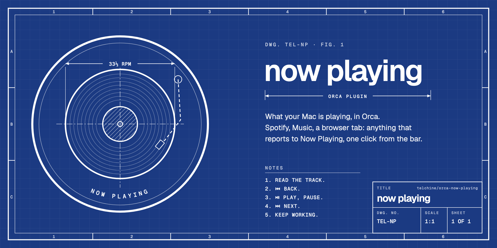

# orca-now-playing

What your Mac is playing, inside [Orca](https://github.com/stablyai/orca). It reads macOS Now Playing, so it follows Spotify, Music, a browser tab, or anything else that reports there, and it puts back, play/pause and next one click away.

## What it adds

| Where | What |
| --- | --- |
| Status bar | `⏮  ▷ title · artist  ⏭`. Click the track to play or pause. |
| Right sidebar | The **Now Playing** panel (▶ icon): title, artist, progress, and the three controls. |
| Command palette | **Now Playing: Play/Pause**, **Next**, **Previous**. Bind them to keys if you like. |
| Settings | Settings → Plugins → Now Playing → **Show in status bar**. On by default. |

## Install

```sh
brew install media-control
git clone https://github.com/telchine/orca-now-playing
orca plugin dev watch ./orca-now-playing
```

Orca prints what the plugin asks for and the command to approve it: its own worker process, its own settings, three commands and the status bar items.

`media-control` is there because macOS 15.4 and later only lets entitled processes read Now Playing. macOS only, for the same reason.

## How it works

| File | What it is |
| --- | --- |
| `src/worker.ts` | Runs `media-control`, maps its JSON to a track, keeps the status bar current every 2 s, answers the panel and the commands. |
| `src/panel.tsx` | The sidebar panel, drawn with Orca's own components. Refreshes every second while visible. |
| `src/protocol.ts` | The panel ↔ worker contract, typed once. |
| `assets/banner.py` | Draws the banner above. |

## Commands

```sh
orca plugin test .       # worker and panel tests
orca plugin check .      # validate, then render the panel against the real worker
orca plugin validate .   # the manifest alone
```

## Known limits

- **No album art.** macOS hands it over, but Orca's `Image` refuses inline `data:` sources and panels have no network. An HTML panel might get around it; untried.
- **Fixed places.** Plugins can live in the right sidebar and the status bar only. The left sidebar's card slot is reserved by Orca and not open to plugins yet.
